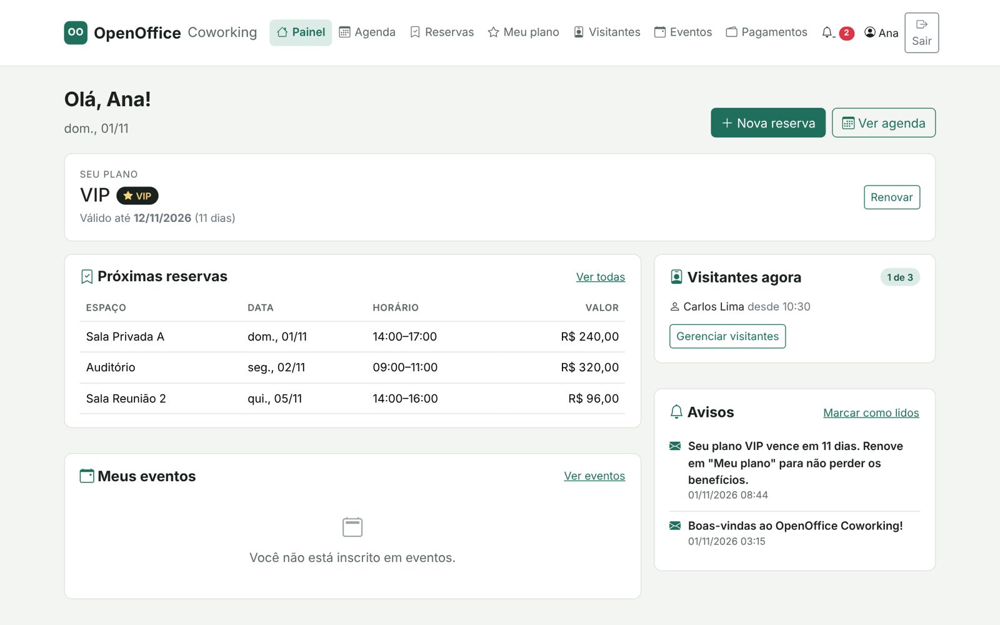
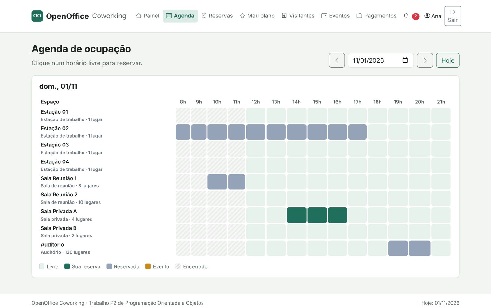
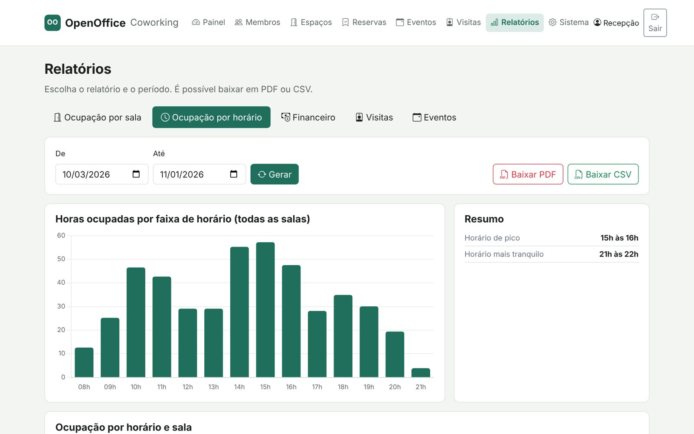
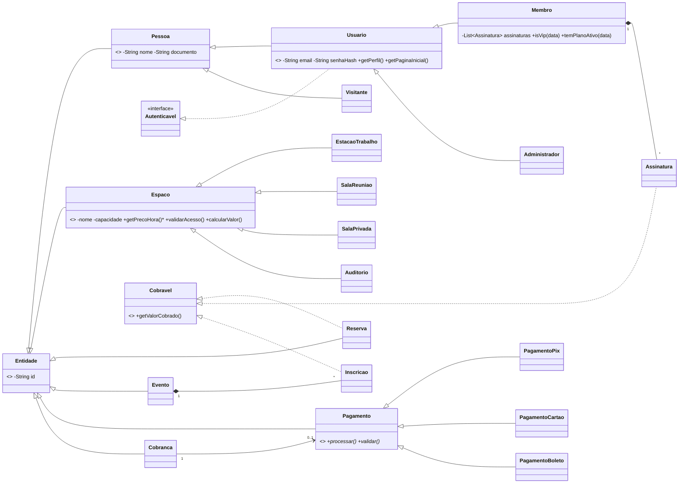

# OpenOffice Coworking

Sistema web de gestão de coworking: espaços, reservas, planos de assinatura, visitantes, eventos, pagamentos e relatórios.

Trabalho da P2 de **Programação Orientada a Objetos (Java)**.

- **Interface:** web (Spring Boot + Thymeleaf), abre no navegador em `http://localhost:8080`
- **Persistência:** arquivos **JSON** na pasta `data/`, sem banco de dados
- **Relatórios:** na tela (com gráficos), em **PDF** (iText) e em **CSV**
- **Desafio:** sincronização dos dados com o **Google Drive** (opcional)

| Painel do membro | Agenda de ocupação | Relatórios |
|---|---|---|
|  |  |  |

O **relatório final** está em [`docs/Relatorio_Final_P2.pdf`](docs/Relatorio_Final_P2.pdf). O arquivo-fonte, editável, é [`docs/relatorio/relatorio.html`](docs/relatorio/relatorio.html).

---

## 1. Como executar

### Requisitos

| Ferramenta | Versão | Observação |
|---|---|---|
| Java (JDK) | **17 ou superior** | Confira com `java -version` |
| Maven | não precisa instalar | O projeto inclui o Maven Wrapper (`mvnw`) |
| Navegador | qualquer um atual | Chrome, Edge, Firefox... |

Na primeira execução o Maven baixa as dependências da internet. Depois disso, o sistema funciona offline.

### Passo a passo

1. Clone o repositório e entre na pasta:

   ```bash
   git clone <url-do-repositorio>
   cd openoffice-coworking
   ```

2. Inicie o sistema:

   - **Linux / macOS**

     ```bash
     ./mvnw spring-boot:run
     ```

   - **Windows (PowerShell ou CMD)**

     ```bash
     mvnw.cmd spring-boot:run
     ```

3. Quando aparecer `Started OpenOfficeApplication`, abra **http://localhost:8080**.

4. Entre com uma das contas de demonstração:

| Perfil | E-mail | Senha | Situação |
|---|---|---|---|
| Administrador | `admin@openoffice.com` | `admin123` | Acesso à gestão |
| Membro VIP | `ana@email.com` | `123456` | Plano VIP ativo |
| Membro VIP | `elisa@email.com` | `123456` | Plano VIP ativo |
| Membro Mensal | `bruno@email.com` | `123456` | Plano Mensal ativo |
| Membro Semanal | `carla@email.com` | `123456` | Plano Semanal ativo |
| Membro Mensal | `felipe@email.com` | `123456` | Plano Mensal ativo |
| Membro sem plano | `diego@email.com` | `123456` | Plano Diário vencido |

Os dados de demonstração (membros, espaços, cerca de um mês de reservas, eventos e visitas) são criados **apenas na primeira execução**. Para recomeçar do zero, pare o sistema e apague a pasta `data/`.

### Pela IDE

- **IntelliJ IDEA:** *File → Open* → selecione a pasta do projeto (é reconhecida como projeto Maven) → execute a classe `br.com.openoffice.OpenOfficeApplication`.
- **Eclipse:** *File → Import → Maven → Existing Maven Projects* → execute `OpenOfficeApplication` como *Java Application*.
- **VS Code:** instale o *Extension Pack for Java*, abra a pasta e clique em *Run* na classe `OpenOfficeApplication`.

### Outros comandos

| Comando | O que faz |
|---|---|
| `./mvnw test` | Roda os 43 testes automatizados (JUnit 5) |
| `./mvnw package` | Gera `target/openoffice-coworking-1.0.0.jar` |
| `java -jar target/openoffice-coworking-1.0.0.jar` | Executa o `.jar` gerado |
| `./mvnw spring-boot:run -Dspring-boot.run.arguments=--server.port=9090` | Usa outra porta |

**Simular uma data (útil para ensaiar a apresentação):**

```bash
./mvnw spring-boot:run -Dspring-boot.run.arguments=--openoffice.relogio-fixo=2026-11-23T09:00
```

---

## 2. Funcionalidades

### Requisitos do enunciado

| Requisito | Onde está | Regras implementadas |
|---|---|---|
| Cadastro de espaços | Admin → Espaços | Estação de trabalho (incluída no plano), Sala de reunião **R$ 60/h**, Sala privada **R$ 80/h, só VIP**, Auditório **R$ 200/h**, com capacidade e disponibilidade (ativo/desativado) |
| Controle de reservas | Membro → Reservas / Agenda | Sem sobreposição de horários; dentro da capacidade; VIP reserva com até **30 dias** de antecedência, os demais com até **7 dias**; horário de funcionamento das 08h às 22h, em blocos de 30 min |
| Cancelamento | Membro → Reservas → Cancelar | Com menos de **24h**, retém **50%** do valor (multa); com 24h ou mais, reembolso integral |
| Planos | Membro → Meu plano | Diário **R$ 50**, Semanal **R$ 200**, Mensal **R$ 600**, VIP **R$ 900/mês**; renovação sem perder dias |
| Benefícios VIP | Automático | Acesso às salas privadas; **20%** de desconto em sala de reunião e auditório; **15%** em eventos especiais; pré-venda de eventos; 30 dias de antecedência |
| Visitantes | Membro → Visitantes / Admin → Visitas | Só membro com plano ativo autoriza; **máximo de 3 ao mesmo tempo**; entrada, saída e histórico |
| Eventos e workshops | Admin → Eventos / Membro → Eventos | Reserva o espaço (sem conflito), vagas limitadas pela capacidade, **inscrições primeiro para VIP**, desconto VIP em eventos especiais |
| Pagamentos | Membro → Pagamentos | PIX, cartão (validação de Luhn, validade, CVV, parcelas) e boleto, simulados; histórico financeiro; cobranças pendentes |
| Relatórios | Admin → Relatórios | Ocupação por sala, **ocupação por horário e sala** (mapa de calor), financeiro, visitas e eventos, com gráfico, PDF e CSV |

### Autenticação e perfis

- Login com e-mail e senha. As senhas ficam guardadas apenas como **hash BCrypt**.
- Depois de **5 tentativas erradas**, o e-mail fica bloqueado por 5 minutos.
- O id da sessão é trocado no login, para evitar fixação de sessão.
- Perfis:
  - **Administrador:** acessa `/admin/**`.
  - **Membro:** acessa `/membro/**`.
  - **Visitante:** não faz login.
- Acesso indevido mostra a página **403**. Quem não fez login é levado para a tela de login.

### Funcionalidades extras (criatividade)

- **Agenda visual de ocupação:** grade por sala e hora. Clicar num horário livre abre a reserva já preenchida.
- **Reserva em 2 passos:** resumo com valor, desconto e total antes de pagar, como num checkout.
- **Sugestão de horário:** quando há conflito, o sistema sugere o horário livre mais próximo.
- **Lista de espera em eventos:** quando alguém cancela, o primeiro da fila ganha a vaga e é avisado.
- **Avisos no painel:** plano vencendo, vaga liberada, reserva cancelada pela administração.
- **Painel do administrador:** membros ativos, reservas do dia, visitantes no prédio, receita do mês e agenda.
- **Log de auditoria** em TXT (`data/auditoria.log`): logins, reservas, pagamentos, cancelamentos.
- **Backup automático** dos JSON a cada inicialização (mantém os 10 mais recentes) e backup manual.
- **Exportação CSV**, além do PDF, que abre direto no Excel.
- **Alteração de senha** pelo próprio membro.
- **Telas responsivas:** funcionam no celular.

---

## 3. Arquitetura

```
navegador ──► Controller (web) ──► Service (regras de negócio) ──► Repository ──► arquivo .json
                    ▲                        │
                    └── mensagem de erro ◄───┘  (exceção de regra de negócio)
```

| Pacote | Responsabilidade |
|---|---|
| `model` | Entidades do domínio: `Pessoa`, `Membro`, `Espaco`, `Reserva`, `Evento`, `Pagamento`... |
| `enums` | `TipoPlano`, `TipoEspaco`, `FormaPagamento`, `StatusReserva`... (com comportamento) |
| `interfaces` | `Autenticavel`, `Cobravel` |
| `regra` | `RegrasCoworking` (constantes) e `PoliticaCancelamento` (regra das 24h) |
| `repository` | `Repositorio<T>` (interface genérica) → `RepositorioJson<T>` → um repositório por entidade |
| `service` | Regras de negócio: reservas, planos, eventos, visitantes, financeiro, relatórios, login |
| `exception` | `RegraNegocioException` e subclasses (`HorarioIndisponivelException`, `CapacidadeExcedidaException`...) |
| `report` | `RelatorioTabela` e os exportadores `ExportadorPdf` (iText) e `ExportadorCsv` |
| `integration` | `GoogleDriveService` (desafio) |
| `web` | Controllers, formulários, sessão/interceptor de login e tratador global de erros |
| `config` | Relógio do sistema, BCrypt e dados de demonstração |

### Por que o Spring é usado só na camada web?

O foco da disciplina é POO. Por isso as regras ficam em classes Java comuns (`model` e `service`):

- **Sem JPA e sem banco.** O repositório JSON foi escrito à mão (`RepositorioJson<T>`), o que mostra *generics*, herança e abstração.
- **Login próprio** (3 classes: `Sessao`, `AutenticacaoInterceptor`, `AutenticacaoService`) em vez do Spring Security.
- **Injeção de dependência pelo construtor**, sem `@Autowired` em atributos. Assim fica explícito o que cada classe usa.

---

## 4. Aplicação dos princípios de POO

| Princípio | Onde | Justificativa |
|---|---|---|
| **Abstração** | `Pessoa`, `Usuario`, `Espaco`, `Pagamento`, `Entidade`, `RepositorioJson<T>` são classes abstratas | Representam conceitos gerais que nunca existem sozinhos. Não há um "espaço genérico", só tipos concretos de espaço |
| **Herança** | `Pessoa → Usuario → Membro / Administrador`; `Pessoa → Visitante`; `Espaco → EstacaoTrabalho / SalaReuniao / SalaPrivada / Auditorio`; `Pagamento → PagamentoPix / PagamentoCartao / PagamentoBoleto` | Os dados e comportamentos comuns (nome, documento, login, capacidade, valor) ficam num só lugar |
| **Polimorfismo** | `espaco.getPrecoHora()`, `espaco.validarAcesso()`, `pagamento.processar()`, `usuario.getPaginaInicial()`, `ExportadorRelatorio.exportar()` | O `ReservaService` não sabe que tipo de sala está reservando: cada subclasse aplica o próprio preço, desconto e regra de acesso. A `SalaPrivada` sobrescreve `validarAcesso()` para exigir VIP |
| **Encapsulamento** | Atributos `private`, validação nos setters/construtores, listas devolvidas como somente leitura, `Entidade.definirId()` só aceita um valor | Um objeto nunca fica em estado inválido (ex.: capacidade 0, e-mail inválido, estação com capacidade diferente de 1) |
| **Interfaces** | `Cobravel` (plano, reserva e inscrição geram cobrança), `Autenticavel`, `Repositorio<T>`, `ExportadorRelatorio` | O `FinanceiroService` cobra qualquer `Cobravel` sem conhecer as classes concretas. Um formato novo de relatório é só mais uma classe |
| **Template Method** | `Espaco.calcularValor()` e `Pagamento.processar()` (métodos `final`) | O algoritmo é fixo e as subclasses preenchem só os detalhes (preço, desconto, validação, comprovante) |
| **Factory Method** | `TipoEspaco.criar()` e `FormaPagamento.criarPagamento()` | Cada constante do enum sabe criar o seu objeto, o que evita `switch` espalhado pelo código |
| **Exceções personalizadas** | `RegraNegocioException` e 11 subclasses | Cada regra do enunciado tem uma exceção com mensagem clara, tratada sem derrubar o sistema |

### Diagrama de classes (resumido)



---

## 5. Persistência e tratamento de erros

- Cada entidade tem o seu arquivo: `data/usuarios.json`, `espacos.json`, `reservas.json`, `eventos.json`, `cobrancas.json`, `pagamentos.json`, `visitantes.json`, `visitas.json`, `notificacoes.json`.
- As subclasses são preservadas no JSON (campo `"tipo"`, `"perfil"` ou `"forma"`). Uma `SalaPrivada` volta como `SalaPrivada`.
- A gravação é **atômica**: o sistema escreve num arquivo temporário e depois substitui o original.
- **Arquivo ausente:** o sistema começa com a lista vazia e mostra um aviso no painel do administrador.
- **Arquivo corrompido:** o arquivo é movido para `data/backup/corrompidos/` e o sistema continua funcionando.
- **Entradas inválidas:**
  - Validação dos formulários com mensagens em português.
  - Datas e números malformados mostram a página 400.
  - Registros inexistentes mostram a página 404.
  - Qualquer erro inesperado mostra uma página amigável (500), sem *stack trace*.
- **Dados de cartão:** apenas os 4 últimos dígitos são gravados. Número completo e CVV nunca vão para o arquivo.

---

## 6. Desafio: Google Drive (opcional)

O sistema funciona normalmente sem essa configuração.

1. Acesse o [Google Cloud Console](https://console.cloud.google.com/) e crie um projeto.
2. Em **APIs e serviços → Biblioteca**, ative a **Google Drive API**.
3. Em **Tela de permissão OAuth**, configure o app como *Externo* e adicione o seu e-mail como **usuário de teste**.
4. Em **Credenciais → Criar credenciais → ID do cliente OAuth**, escolha **App para computador** e baixe o JSON.
5. Salve o arquivo como `credentials.json` na raiz do projeto.
6. Copie o arquivo de configuração de exemplo:

   - **Linux / macOS**

     ```bash
     cp .env.example .env
     ```

   - **Windows**

     ```bash
     copy .env.example .env
     ```

7. Inicie o sistema, entre como administrador e abra **Sistema → Enviar dados**.
8. Na primeira vez o navegador abre para você autorizar o acesso. O token fica salvo na pasta `tokens/`.

O sistema cria a pasta **"OpenOffice Coworking - dados"** no seu Drive e envia os arquivos JSON e o log de auditoria. **Restaurar do Drive** baixa os arquivos de volta (antes, faz um backup local) e recarrega os dados sem reiniciar.

> O escopo usado é `drive.file`: o sistema só enxerga os arquivos que ele mesmo criou.
>
> `credentials.json`, `.env` e `tokens/` estão no `.gitignore` e **não devem ser enviados ao GitHub**.

---

## 7. Testes

```bash
./mvnw test
```

São 43 testes, entre eles:

- `ReservaServiceTest`:
  - desconto VIP;
  - sobreposição de horários (com sugestão de horário livre);
  - capacidade;
  - sala privada só para VIP;
  - antecedência de 7 e 30 dias;
  - horários inválidos;
  - multa de 50% no cancelamento;
  - cartão recusado (nada é gravado);
  - estação de trabalho gratuita.
- `EventoServiceTest`: pré-venda VIP, desconto de 15%, lista de espera com promoção automática, capacidade e conflito.
- `VisitanteServiceTest`: limite de 3 visitantes, plano ativo, visitante duplicado.
- `PlanoEAutenticacaoTest`: preços, renovação, hash BCrypt, bloqueio por tentativas, CPF e e-mail duplicados.
- `EspacoPolimorfismoTest`: preços e descontos por subclasse, `validarAcesso` sobrescrito, vencimento do plano, validações.
- `RepositorioJsonTest`: leitura polimórfica, arquivo ausente, arquivo corrompido, backup, cartão não gravado.
- `NavegacaoWebTest`: login, controle de acesso por perfil (403), páginas 404 e 400, exportação de PDF.

Os testes usam uma pasta de dados temporária e um relógio fixo (`openoffice.relogio-fixo`). Assim os resultados não dependem do dia em que são executados.

---

## 8. Bibliotecas

| Biblioteca | Versão | Motivo |
|---|---|---|
| Spring Boot (Web, Thymeleaf, Validation) | 3.3.5 | Servidor web embutido, páginas HTML e validação de formulários |
| Jackson (incluso no Spring) | 2.17 | Leitura e gravação dos arquivos JSON |
| spring-security-crypto | 6.3 | Apenas o BCrypt, para guardar as senhas com segurança |
| iText (kernel + layout) | 8.0.5 | Geração dos relatórios em PDF (recomendação do professor) |
| Bootstrap + Bootstrap Icons (WebJars) | 5.3.3 / 1.11.3 | Layout responsivo; empacotados no projeto, funcionam sem internet |
| Chart.js (WebJar) | 4.4.1 | Gráficos dos relatórios |
| Google API Client + Drive API | 2.7.0 / v3 | Desafio do Google Drive |
| JUnit 5 + AssertJ + MockMvc | (Spring Boot Test) | Testes automatizados |

---

## 9. Regerar o relatório em PDF

Depois de editar `docs/relatorio/relatorio.html` (preencher nomes e experiências), abra o arquivo no navegador e use **Imprimir → Salvar como PDF** (A4, com "Gráficos de plano de fundo" marcado).

---

## 10. Limitações conhecidas

- Os pagamentos são **simulados**: não há integração com banco ou gateway.
- Não há proteção CSRF nos formulários. O sistema foi pensado para uso local. Num ambiente real, o Spring Security resolveria isso.
- O controle de concorrência é feito por `synchronized` nos repositórios, adequado para um único servidor.
- A vaga liberada pela lista de espera fica reservada até o pagamento, sem prazo de expiração.
